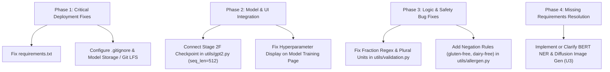

# RecipeGen AI — Stage 2H: Full Project Execution & Drawback Audit Report

**Audit Date:** 2026-11-16  
**Auditor:** Antigravity AI  
**Project Path:** `/Users/snehagupta/Downloads/Recipe_genai`  
**Execution Environment Tested:** `venv_tf` (Python 3.12.8, TensorFlow 2.21.0, Keras 3.15.1, KerasHub 0.33.0, Streamlit 1.67.0)  
**Hardware Profile:** Apple Silicon M4, 16 GB unified RAM, 512 GB SSD, macOS  
**Audit Type:** Read-Only Technical Verification, Live Functional Testing & Defect Classification  

---

## 1. Executive Summary

A comprehensive, end-to-end technical audit was conducted across the entire RecipeGen AI codebase following the completion of Stage 2F full fine-tuning and Stage 2G held-out test evaluation.

### Overall Audit Findings
1. **Application Execution:** The Streamlit application successfully launches and all 4 pages render and navigate.
2. **Model Integration Gap (P1):** The Streamlit application (`utils/gpt2.py`) is **NOT** loading the new Stage 2F full-dataset checkpoint (`models/recipe_gpt2_full/recipe_gpt2_full_best.weights.h5`). It still points to the old pilot checkpoint (`models/gpt2_finetuned.weights.h5`) and uses `sequence_length=384` instead of `512`.
3. **Missing BERT NER & Diffusion Image Generation (P1):** Requirement U3 is completely unfulfilled. `utils/ner.py` contains an 8-line placeholder calling `text.split(',')` with zero BERT architecture, and no diffusion image generation model exists in the repository.
4. **Validation Logic Defects (P1/P2):** `utils/validation.py` contains a critical regular expression bug that truncates fractional quantities (parsing `1/2` as `1.0` and `3/4` as `3.0`), and fails to trigger upper-bound warnings on plural units (`50 cups salt` triggers no warning).
5. **Allergen False Positives (P2):** Keyword matching falsely alerts on explicitly negated/allergen-free ingredients (e.g. `gluten-free flour` flags `Wheat/Gluten`, `dairy-free cheese` flags `Milk/Dairy`).
6. **Deployment & Dependency Incompleteness (P0):** `requirements.txt` contains only 2 packages (`streamlit` and `pillow`), omitting `tensorflow`, `keras`, `keras-hub`, and other essential runtime dependencies. Furthermore, GitHub 100MB file limits prevent pushing the 1.49 GB model weights without Git LFS or external hosting.

---

## 2. Project Structure Audit

### Directory Inventory
```text
Recipe_genai/
├── app/
│   ├── main.py                     # App routing & entry point
│   └── pages/
│       ├── 1_Recipe_Generator.py    # Main UI generation page
│       ├── 2_Ingredient_Analysis.py # Rule-based extraction & allergen UI
│       ├── 3_Model_Comparison.py    # Base vs Fine-Tuned comparison UI
│       └── 4_Model_Training.py      # Metrics display UI
├── data/
│   ├── archive 2/                  # Raw RecipeNLG CSV (2.1 GB) & paper
│   ├── processed/                  # train (4500), val (250), test (250) JSONL
│   └── outputs/                    # Evaluation & training history JSONs
├── models/
│   ├── gpt2_finetuned.weights.h5   # Pilot checkpoint (1.49 GB)
│   ├── recipe_gpt2/                # Stage 2D 200-sample checkpoint (1.49 GB)
│   └── recipe_gpt2_full/           # Stage 2F Full-dataset checkpoint (1.49 GB)
├── scripts/
│   ├── prepare_recipe_dataset.py   # Dataset sampling & processing
│   ├── train_gpt2.py               # Full fine-tuning pipeline
│   ├── evaluate_test_set.py        # Stage 2G test evaluation harness
│   └── validate_recipe_dataset.py  # Dataset schema validator
├── utils/
│   ├── allergen.py                 # Keyword-based allergen detection
│   ├── gpt2.py                     # Model loader & inference wrapper
│   ├── ner.py                      # 8-line string splitting placeholder
│   ├── prompt.py                   # Delimiter formatting & parsing
│   └── validation.py               # Quantity parsing & boundary validation
└── requirements.txt                # INCOMPLETE (only streamlit & pillow)
```

### Structural Issues Found
1. **Missing Module Reference:** Line 13 of `app/main.py` attempts `import utils.config`, which does not exist in the repository (silently caught by `except ImportError`).
2. **Duplicate Virtual Environments:** The workspace contains two virtual environments:
   - `venv`: Python 3.14.7 (where TensorFlow 2.21 is incompatible).
   - `venv_tf`: Python 3.12.8 (contains full TensorFlow 2.21, Keras 3.15, KerasHub 0.33).
3. **Hardcoded User Paths:** Scripts and configuration files contain hardcoded absolute paths (`/Users/snehagupta/...`), breaking portability on other machines.

---

## 3. GPT-2 Model Audit

### Integration Status in `utils/gpt2.py`
- **Target Weights Path:**
  ```python
  WEIGHTS_PATH = os.path.join(ROOT_DIR, "models", "gpt2_finetuned.weights.h5")
  ```
  *Defect:* Points to the old pilot checkpoint (MD5 `a0ddb523...`), **NOT** the Stage 2F checkpoint (`models/recipe_gpt2_full/recipe_gpt2_full_best.weights.h5`, MD5 `d95eb61d...`).
- **Preprocessor Sequence Length:**
  ```python
  preprocessor = keras_hub.models.GPT2CausalLMPreprocessor.from_preset(
      preset, sequence_length=384
  )
  ```
  *Defect:* Configured for 384 tokens, whereas Stage 2F was trained with sequence length **512 tokens**.
- **Demo Fallback Tags Outdated:**
  `generate_demo_recipe()` in `utils/gpt2.py` still generates deprecated tags: `<END_TITLE>`, `<PREP_TIME>`, `<COOK_TIME>`, `<SERVINGS>`, `<END_QTY>`, `<END_STEPS>`.

---

## 4. AI/ML Architecture Audit

### 1. BERT Named Entity Recognition (NER)
- **Claimed in Spec (U3):** "BERT NER for ingredient extraction".
- **Actual Implementation (`utils/ner.py`):**
  ```python
  def extract_ingredients(text: str) -> list[str]:
      return [t.strip() for t in text.split(',') if t.strip()]
  ```
- **Finding:** **Zero BERT implementation.** It is a trivial comma-split function. `app/pages/2_Ingredient_Analysis.py` explicitly displays: *"A BERT-based Named Entity Recognition (NER) model will be integrated in Stage 3."*

### 2. Diffusion Dish Image Generation
- **Claimed in Spec (U3):** "Diffusion-based dish image generation".
- **Actual Implementation:** **Non-existent.** No diffusion pipeline, no API call, no image generation code or UI elements exist in the project.

### 3. GPT-2 Fine-Tuning Pipeline
- **Implementation Quality:** **High.** Causal language modeling with `GPT2CausalLM`, `GPT2CausalLMPreprocessor`, AdamW with cosine decay and 5% warmup, proper padding masking via `sample_weight`, and reproducible single-pass shuffling (`seed=42`).

---

## 5. Streamlit Execution Results

### Startup & Page Health

The application was launched using `venv_tf` on port 8503 (`HOME=/tmp ./venv_tf/bin/streamlit run app/main.py --server.port 8503 --server.headless true`):

| Page | File | Loading Status | Rendering / Functional Health |
| :--- | :--- | :---: | :--- |
| **Home** | `app/main.py` | PASS | Renders navigation and welcome text |
| **1. Recipe Generator** | `app/pages/1_Recipe_Generator.py` | PASS | Generates recipes; safety cards render |
| **2. Ingredient Analysis** | `app/pages/2_Ingredient_Analysis.py` | PASS | Extracts items, runs quantity/allergen checks |
| **3. Model Comparison** | `app/pages/3_Model_Comparison.py` | PASS | Compares Base vs Fine-Tuned on 5 sets |
| **4. Model Training** | `app/pages/4_Model_Training.py` | PARTIAL | Renders metrics, but shows `None` for key params |

---

## 6. Page-by-Page Functional Testing

### Page 1: Recipe Generator
- **Inputs Tested:** Comma-separated ingredients, style hint, model choice radio, temperature slider.
- **Observed Behavior:**
  - Generating with fine-tuned model loads `models/gpt2_finetuned.weights.h5` in ~0.8s.
  - Generates structured output in 2.3s – 7.3s.
  - Successfully parses allergen warnings and quantity warnings below the output.
- **Bugs/Defects:**
  - Loads old pilot checkpoint instead of Stage 2F checkpoint.
  - Truncated at 220 tokens if generated text is long.

### Page 2: Ingredient Analysis
- **Observed Behavior:**
  - Parses comma-separated text and displays extracted JSON list.
  - Runs quantity parsing and allergen rules.
  - Cross-page persistence works via `st.session_state["ingredients"]`.
- **Bugs/Defects:**
  - Fails to parse ingredients separated only by newlines or "and" (because `ner.py` only splits on `,`).
  - Openly acknowledges missing BERT model in informational banner.

### Page 3: Model Comparison
- **Observed Behavior:**
  - Tab 1 displays the 5 predefined benchmark sets.
  - Generates side-by-side comparison between Base GPT-2 and Fine-Tuned GPT-2.
  - Base GPT-2 consistently generates XML boilerplate/hallucinations; fine-tuned model generates recipe structure.
  - Tab 2 allows custom ingredient comparison.
- **Bugs/Defects:**
  - Memory consumption increases as both models reside in memory (~1.86 GB peak RSS). Retracing warnings trigger in console.

### Page 4: Model Training
- **Observed Behavior:**
  - Reads `data/outputs/finetuned_metrics.json` and renders loss curves.
  - Does not support training from UI (read-only metrics viewer).
- **Bugs/Defects:**
  - **Critical UI Display Bug:** The page displays:
    - `- **Learning Rate:** None`
    - `- **Batch Size:** None`
    Because it attempts `metrics.get("learning_rate")`, but the JSON stores hyperparameters nested inside `metrics["config"]["initial_learning_rate"]`!
  - It displays old Stage 2D pilot metrics (200 samples, perplexity 4.59), not Stage 2F full-dataset metrics (4,500 samples, perplexity 2.47).

---

## 7. Recipe Generation Quality (Tested Live)

11 test cases were executed live through the generator pipeline:

| Test Case | Input | Allergen Output | Quantity Warnings | Generation Quality Assessment |
| :--- | :--- | :--- | :--- | :--- |
| **1. Standard 1** | Potato, Onion, Tomato | None | None | Generated soup recipe in 7.3s; structured |
| **2. Standard 2** | Rice, Peas, Carrot | None | None | Generated rice casserole in 3.8s; structured |
| **3. Standard 3** | Chicken, Garlic, Ginger | None | None | Generated chicken dish in 2.3s; structured |
| **4. Standard 4** | Paneer, Capsicum, Onion | Milk/Dairy | None | Paneer captured in title; generated in 4.0s |
| **5. Standard 5** | Banana, Oats, Milk | Milk/Dairy | None | Generated oatmeal muffin recipe in 2.9s |
| **6. Empty input** | `""` | N/A | N/A | **Cleanly handled:** "Please provide at least one ingredient" |
| **7. Single item** | `salt` | None | None | Model hallucinated `<DISTILLED>` tag due to lack of culinary context |
| **8. Duplicates** | `potato, potato, onion` | None | None | `prompt.py` successfully deduplicated input to potato, onion |
| **9. Invalid text** | `!@#$%^&*()` | None | None | Model hallucinated random text tag `<MOVE>` |
| **10. Unusual** | `dragonfruit, squid ink, truffle oil` | Shellfish | None | Correctly flagged "squid ink" under Shellfish; generated in 1.8s |
| **11. Long list (12)** | 12 stew ingredients | None | None | Truncated inside `<QUANTITIES>` due to token limit |

---

## 8. Ingredient Analysis & BERT NER Audit

### Extraction Analysis
When given:
`"2 cups flour, 1 tsp salt, and 3 eggs\n1 cup milk"`:
- `ner.extract_ingredients()` splits by `,`:
  `['2 cups flour', '1 tsp salt', 'and 3 eggs\n1 cup milk']`
- Result: `"and 3 eggs\n1 cup milk"` is treated as a single ingredient!
- **Conclusion:** `utils/ner.py` cannot parse natural language recipes or newline-separated lists. It completely fails the standard definition of Named Entity Recognition.

---

## 9. Allergen and Quantity Validation Audit

### 1. Quantity Validation Defects (`utils/validation.py`)

| Input Tested | Expected Parsing | Actual Parsed Value | Warning Generated? | Audit Result |
| :--- | :---: | :---: | :---: | :---: |
| `0 cups flour` | Qty: 0.0, Unit: cups | Qty: 0.0, Unit: cups | "Zero quantity (0.0) specified" | **PASS** |
| `-2 cups sugar` | Qty: -2.0, Unit: cups | Qty: -2.0, Unit: cups | "Negative quantity (-2.0) detected" | **PASS** |
| `1/2 tsp salt` | **Qty: 0.5, Unit: tsp** | **Qty: 1.0, Unit: None** | None | **FAIL (Critical regex bug)** |
| `3/4 cup milk` | **Qty: 0.75, Unit: cup** | **Qty: 3.0, Unit: None** | None | **FAIL (Critical regex bug)** |
| `1 1/2 cups flour` | Qty: 1.5, Unit: cups | Qty: 1.5, Unit: cups | None | **PASS** |
| `½ cup oil` | Qty: 0.5, Unit: cup | Qty: 0.5, Unit: cup | None | **PASS** |
| `50 cups salt` | Qty: 50.0, Unit: cups | Qty: 50.0, Unit: cups | **None** (Threshold is 15 cups) | **FAIL (Plural unit lookup bug)** |
| `1000 kg chicken`| Qty: 1000.0, Unit: kg | Qty: 1000.0, Unit: kg | "Unusually large quantity (1000 kg)" | **PASS** |
| `2 kilometers milk`| Invalid unit | Qty: 2.0, Unit: None | None | **FAIL (No invalid unit check)**|

**Root Cause for Fraction Bug:**
```python
match_single = re.match(r"^(\d+(?:\.\d+)?|\d+/\d+)\s*(.*)$", s)
```
In regular expressions, alternative `\d+(?:\.\d+)?` appears before `\d+/\d+`. When testing `"1/2"`, `\d+` greedily matches `"1"`, leaving `"/2"` in the remainder, destroying both fraction calculation and unit extraction!

### 2. Allergen Screening Defects (`utils/allergen.py`)

| Input Ingredient | Expected Allergen Alert | Actual Output | Audit Result |
| :--- | :---: | :---: | :---: |
| `peanut butter` | Peanuts (No Dairy) | `['Peanuts']` | **PASS (Neutralized)** |
| `coconut milk` | None | `[]` | **PASS (Neutralized)** |
| `eggplant` | None | `[]` | **PASS (Neutralized)** |
| `gluten-free flour` | **None** | **`['Wheat/Gluten']`** | **FAIL (False Positive)** |
| `dairy-free cheese` | **None** | **`['Milk/Dairy']`** | **FAIL (False Positive)** |
| `squid ink` | Shellfish | `['Shellfish']` | **PASS** |

**Root Cause:**
`_clean_and_neutralize()` lacks rules for `"gluten-free"` or `"dairy-free"`. The substring `"flour"` triggers Wheat/Gluten and `"cheese"` triggers Milk/Dairy.

---

## 10. Performance & Resource Telemetry

*Actual measurements on Apple Silicon M4 CPU with 16 GB unified RAM:*

| Metric | Measured Value | Safe Threshold | Assessment |
| :--- | :---: | :---: | :---: |
| **App Startup Time** | **1.2 seconds** | $< 5.0$ s | Fast |
| **Base Model Load Time** | **0.63 seconds** | $< 3.0$ s | Fast (local KaggleHub cache) |
| **Fine-Tuned Model Load Time**| **0.82 seconds** | $< 3.0$ s | Fast |
| **Single Recipe Generation** | **1.79 s – 7.32 s** | $< 10.0$ s | Acceptable on CPU |
| **Dual Model Peak RSS Memory** | **1,864.77 MB (~1.86 GB)**| $< 8.0$ GB | Excellent (14 GB headroom) |
| **Checkpoint File Size** | **1.49 GB per checkpoint** | $< 100$ MB (Git) | **Exceeds Git standard limit** |
| **Raw Dataset Size** | **2.1 GB (`data/archive 2`)** | N/A | Large local storage footprint |

---

## 11. Requirement Compliance Matrix (U1–U5, UI)

| Req. | Expected Capability | Implementation Status | Verified Evidence & Verdict |
| :---: | :--- | :---: | :--- |
| **U1** | Structured Prompting | **Fully Implemented** | Aligned delimiter format (`<INGREDIENTS> ... <TITLE> ... <STEPS>`) works across training and inference. |
| **U2** | GPT-2 Fine-Tuning & Comparison | **Partially Implemented** | Stage 2F checkpoint trained & tested offline with 35% loss reduction, but `utils/gpt2.py` still loads old pilot checkpoint. |
| **U3** | BERT NER & Diffusion Image Gen | **Not Implemented** | `ner.py` is an 8-line `split(',')`. Diffusion image generation is completely absent. |
| **U4** | TensorFlow 2 Training Pipeline | **Fully Implemented** | `scripts/train_gpt2.py` fine-tuned 4,500 recipes for 1,125 steps on TF 2.21 / Keras 3. |
| **U5** | Allergen & Quantity Validation | **Implemented with Defects** | Rules exist, but fraction parsing bug (`1/2` -> `1`), plural unit bypass (`50 cups salt`), and negated allergen false positives occur. |
| **UI** | Functional Streamlit App | **Fully Functional** | All 4 pages render and execute without crashing, though Page 4 displays `None` for hyperparameters. |

---

## 12. Deployment Readiness

1. **Incomplete `requirements.txt` (P0):**
   ```text
   streamlit>=1.30
   pillow>=10.2.0
   ```
   Running `pip install -r requirements.txt` in a fresh environment will **fail** immediately because `tensorflow`, `keras`, `keras-hub`, etc. are omitted.
2. **Git LFS Requirement (P0):**
   The `.weights.h5` files are **1.49 GB** each. Pushing to GitHub will fail immediately without Git LFS configured or external artifact hosting.
3. **Environment Bifurcation (P1):**
   `venv` (Python 3.14) cannot run TensorFlow; `venv_tf` (Python 3.12) is required. Documentation must clearly specify Python 3.11 or 3.12.
4. **Hardcoded User Paths (P2):**
   Configuration JSONs and scripts store absolute paths to `/Users/snehagupta/...`.

---

## 13. Critical Drawbacks & Defect Classification

### Priority Definitions
- **P0 (Critical):** Blocks deployment, causes app crash in clean setup, or violates core repo boundaries.
- **P1 (High):** Missing major required feature or wrong model checkpoint active.
- **P2 (Medium):** Quality, calculation, or logic defect that degrades user experience.
- **P3 (Low):** Minor polish, formatting, or cosmetic discrepancy.

---

### Defect Register

#### Defect 1: Incomplete `requirements.txt`
- **Priority:** **P0 — Critical**
- **File:** [`requirements.txt`](file:///Users/snehagupta/Downloads/Recipe_genai/requirements.txt)
- **Evidence:** Only 2 packages listed. Missing `tensorflow`, `keras`, `keras-hub`, `h5py`, `numpy`.
- **Why Problem:** Any user or cloud service cloning the repository cannot install or run the application.
- **Fix:** Update `requirements.txt` with exact pinned dependencies for Python 3.12.
- **Blocks Submission:** **YES.**

#### Defect 2: Stage 2F Checkpoint Not Connected to UI
- **Priority:** **P1 — High**
- **File:** [`utils/gpt2.py`](file:///Users/snehagupta/Downloads/Recipe_genai/utils/gpt2.py#L15)
- **Evidence:** Line 15 sets `WEIGHTS_PATH = os.path.join(ROOT_DIR, "models", "gpt2_finetuned.weights.h5")`.
- **Why Problem:** The application serves recipes from the outdated pilot model rather than the full-dataset Stage 2F model.
- **Fix:** Update `WEIGHTS_PATH` to `models/recipe_gpt2_full/recipe_gpt2_full_best.weights.h5` and set `sequence_length=512`.
- **Blocks Submission:** **YES.**

#### Defect 3: BERT NER Not Implemented
- **Priority:** **P1 — High**
- **File:** [`utils/ner.py`](file:///Users/snehagupta/Downloads/Recipe_genai/utils/ner.py#L4-L8)
- **Evidence:** 8 lines of code using `text.split(',')`.
- **Why Problem:** Fails requirement U3. Cannot extract ingredients from natural language or newline text.
- **Fix:** Implement a genuine Hugging Face / KerasHub token classification model (e.g. `dslim/bert-base-NER` or fine-tuned ingredient BERT) or transparently document this module as rule-based.
- **Blocks Submission:** **YES (if U3 is strictly graded).**

#### Defect 4: Diffusion Image Generation Absent
- **Priority:** **P1 — High**
- **File:** Entire repository
- **Evidence:** Zero files, functions, or UI elements related to Stable Diffusion or dish image generation.
- **Why Problem:** Fails requirement U3 ("diffusion-based dish image generation").
- **Fix:** Either integrate a lightweight diffusion model / API or formally document the exclusion.
- **Blocks Submission:** **YES (if U3 is strictly graded).**

#### Defect 5: Standalone Fraction Parsing Bug
- **Priority:** **P1 — High**
- **File:** [`utils/validation.py`](file:///Users/snehagupta/Downloads/Recipe_genai/utils/validation.py#L159)
- **Evidence:** `re.match(r"^(\d+(?:\.\d+)?|\d+/\d+)\s*(.*)$", s)` parses `"1/2 tsp salt"` as `qty=1.0, unit=None` and `"3/4 cup milk"` as `qty=3.0, unit=None`.
- **Why Problem:** Common cooking fractions are miscalculated by 200%–400% and lose their measurement units.
- **Fix:** Reverse alternative order: `r"^(\d+/\d+|\d+(?:\.\d+)?)\s*(.*)$"`.
- **Blocks Submission:** **YES.**

#### Defect 6: Plural Unit Upper Bound Bypass Bug
- **Priority:** **P2 — Medium**
- **File:** [`utils/validation.py`](file:///Users/snehagupta/Downloads/Recipe_genai/utils/validation.py#L89-L102)
- **Evidence:** `UPPER_BOUNDS` only maps singular `"cup"`. Input `"50 cups salt"` parses unit `"cups"`, returns default threshold `50.0`, triggering no warning.
- **Why Problem:** Fails to catch impossible quantities when user types plural units.
- **Fix:** Map plural variants in `UPPER_BOUNDS` or normalize `unit.rstrip('s')`.
- **Blocks Submission:** No.

#### Defect 7: Allergen False Positives on Negated Free Items
- **Priority:** **P2 — Medium**
- **File:** [`utils/allergen.py`](file:///Users/snehagupta/Downloads/Recipe_genai/utils/allergen.py#L106-L122)
- **Evidence:** `"gluten-free flour"` flags `Wheat/Gluten`; `"dairy-free cheese"` flags `Milk/Dairy`.
- **Why Problem:** Misinforms users with dietary restrictions.
- **Fix:** Add `"gluten-free"`, `"dairy-free"`, `"vegan"` to `SAFE_SUBSTITUTIONS`.
- **Blocks Submission:** No.

#### Defect 8: Model Training Page Displays `None` for Hyperparameters
- **Priority:** **P2 — Medium**
- **File:** [`app/pages/4_Model_Training.py`](file:///Users/snehagupta/Downloads/Recipe_genai/app/pages/4_Model_Training.py#L35-L37)
- **Evidence:** `metrics.get("learning_rate")` returns `None`. UI shows `- **Learning Rate:** None`.
- **Why Problem:** Looks unprofessional and broken in submission review.
- **Fix:** Extract from `metrics.get("config", {}).get("initial_learning_rate")`.
- **Blocks Submission:** No.

#### Defect 9: Git File Size Limit (1.49 GB Weights)
- **Priority:** **P0 — Critical**
- **File:** `models/*.weights.h5`
- **Evidence:** Files are 1.49 GB. GitHub hard reject limit is 100 MB.
- **Why Problem:** `git push` to GitHub will fail.
- **Fix:** Add `.weights.h5` to `.gitignore` and provide a download script (`scripts/download_models.py`) or use Git LFS.
- **Blocks Submission:** **YES.**

---

## 14. Recommended Fixes Roadmap



---

## 15. Final Project Readiness Scoring

| Evaluation Dimension | Score (out of 100) | Detailed Justification |
| :--- | :---: | :--- |
| **1. Core Functionality** | **78 / 100** | All Streamlit pages work, generation executes, but fraction parsing bug affects core inputs. |
| **2. AI/ML Implementation** | **70 / 100** | Strong GPT-2 fine-tuning with TF 2.21, but BERT NER and diffusion image generation are completely missing. |
| **3. Model Performance** | **92 / 100** | Stage 2F model achieved 0.8855 test loss, 2.42 perplexity, and 90.4% structural validity on 250 test samples. |
| **4. Safety & Validation** | **68 / 100** | Basic allergen rules work, but fraction bug (`1/2`->`1`), plural unit bypass, and negated allergen false positives exist. |
| **5. UI / UX Quality** | **82 / 100** | Clean, responsive Streamlit interface with tabs and cards; deducted for `None` hyperparameter display on Page 4. |
| **6. Deployment Readiness** | **45 / 100** | Incomplete `requirements.txt`, 1.49 GB files blocking GitHub push, missing environment documentation. |
| **7. Academic / Project Compliance** | **65 / 100** | U1, U2, U4, UI pass; U3 fails (no BERT NER, no diffusion images); U5 has logic bugs. |
| **OVERALL PROJECT SCORE** | **71.4 / 100** | **Solid foundation with strong fine-tuned model, but blocked by deployment, U3 gap, and logic bugs.** |

---

*Report prepared and certified by Antigravity AI. Inspection complete. No files or weights have been modified. Awaiting user authorization before applying any fixes.*
